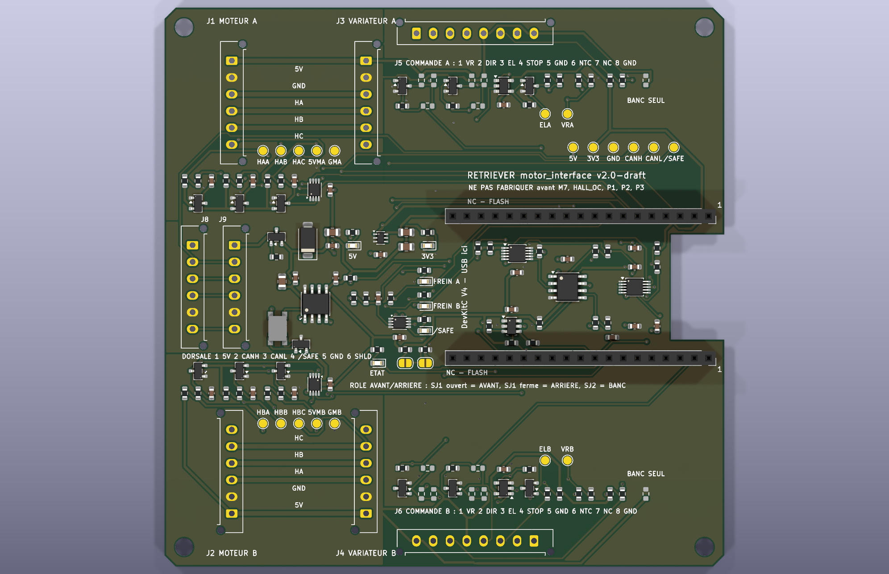

# motor_interface

> **v2.0-draft — do not fabricate before M7, HALL_OC, P1, P2, P3.** Schematic and
> layout generated, ERC and DRC clean (ERC 0, DRC 0 with schematic parity and all severities, 0 unconnected). Every choice and its reason:
> [`decisions.md`](decisions.md) (French). Brief:
> [`cahier-des-charges.md`](cahier-des-charges.md).

  

| | |
|---|---|
| Size | 100 × 100 mm, 4 layers, 4 × M3, antenna notch on the right edge |
| Parts | 123 placed by the assembler (117 SMD + 6 Micro-Fit 6-way); hand-soldered: 2 × Micro-Fit 8-way, 2 × Mill-Max sockets; 14 option footprints not fitted; 20 named test pads |
| Module | ESP32-DevKitC V4 on two 1 × 19 turned-pin sockets, rows 25.40 mm apart (P1 to confirm) |
| Sources | [`kicad/`](kicad/) — KiCad 10 project, **generated** by [`scripts/build.py`](scripts/build.py) |
| Fabrication | [`fab/`](fab/) — Gerber zip, JLCPCB BOM and placement, schematic PDF, renders |

Rebuild everything: `./build.sh` (routing takes several minutes) then `./fab.sh`
(needs the toolchain in [`../outils.md`](../outils.md)). Do not edit the KiCad files
by hand: change `scripts/build.py` and rebuild.

Sits between a MOTION ESP32 and two ZS-X11H drivers with their hub motors. One
reference, two boards in service (front and rear), three spares from a lot of five.
The role is set by a solder jumper read through the ADS1115, not by GPIO straps.

The specification of record is
[`10-spec-motor-interface.md`](../../../docs/architecture/10-spec-motor-interface.md).
The earlier four-motor board is archived in
[`docs/archive/pcb-v1/`](../../../docs/archive/pcb-v1/).

## What changed against the specification (13 November 2026)

| Point | Spec / ICD v1.2 | This board | Why |
|---|---|---|---|
| `5V_BRAKE` | through J5/J6 pin 7, 2200 µF on board | **not on this board**, pin 7 NC | Decision D5: unplugging the board must keep the brake applied |
| Power input | J7 and trunk pin 1 | **trunk only**, J7 removed | One source, nothing to arbitrate |
| Grounds | undefined | **`GND`, `GND_MOT_A`, `GND_MOT_B` kept apart**, bench-only 0 Ω ties not fitted | Decision D4: single star point on `safety_power` |
| DAC supply | 5 V | **3.3 V**, internal 2.048 V reference, op-amp gain 2.5 | `MCP4728` VIH = 0.7 VDD, unreachable from a 3.3 V bus at 5 V |
| Low-side switches | `DMG1012T` (SOT-523) | **`AO3400A`** (SOT-23, JLCPCB basic) | 48 mΩ guaranteed at VGS 2.5 V, hand-reworkable |
| Polarity options | on `DIR`, `STOP`, `EL` | **`DIR` and `STOP` only** | Any option on `EL` could defeat the fail-safe |
| Hall PPTC | 30 mA on the pull-up tap | **removed** | Separate `+5V_MOT_A/B` nets; no PPTC of that size trips before the 78L05 |
| Hall activity LEDs | six | **none** | Test points and the serial console do the same job |

## Scope

| Function | Implementation |
|---|---|
| Hall passthrough | J1→J3, J2→J4: five straight 0.8 mm tracks each, one layer, no via, no part in series |
| Hall tap | 2.2 kΩ pull-up (population option, HALL_OC), 2.2 kΩ + 10 nF / 100 V, `BAT54S` clamp, referenced to `GND_MOT_x`; `SN74LVC3G17` at 3.3 V (Ioff) |
| Speed command | `MCP4728` (3.3 V, internal ref.) → `TLV9062` ×2.5 → `VR`, 0 V with the module out |
| `DIR`, `STOP` | `AO3400A` open drain, gate pull-down; pull-up / pull-down / direct-drive footprints not fitted |
| Brake `EL` | per wheel `74LVC1G08` (`GPIO26` AND `/SAFE`) → `AO3400A`; pull-up on the harness |
| Temperatures, role, revision | `ADS1115` at 0x48: NTC A, NTC B, role divider (SJ1/SJ2), revision divider (½ = v2.0) |
| Watchdog | `TPL5010`, 2 s, `RSTn` on the module `EN` (D7) |
| CAN | `TCAN1042HVDR`, `STB` grounded, `VIO` 3.3 V, `NUP2105L`, `ACT45B`, no termination |
| Power | trunk 5 V → `AO3401A` reverse protection → `SMAJ6.0A` → `LM66100` → module 5 V; 3.3 V from the module |

## Blocking measurements

M7 (Hall output level and impedance), HALL_OC (open collector or push-pull),
HALL_COL (wire colours, silkscreen), P1 to P3 on the ESP32 module (row spacing, pin
order, PSRAM variant). See [`docs/measurements/`](../../../docs/measurements/).

Pinout: `boards.motor_interface` in [`hardware/icd.yaml`](../../icd.yaml) (v1.2; the
changes this board needs for v1.3 are listed at the end of [`decisions.md`](decisions.md)).
