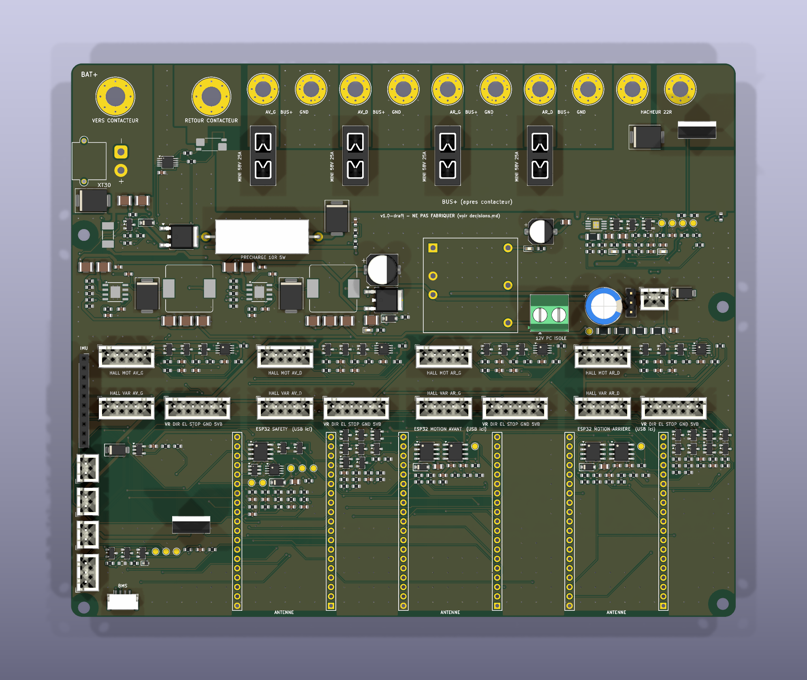
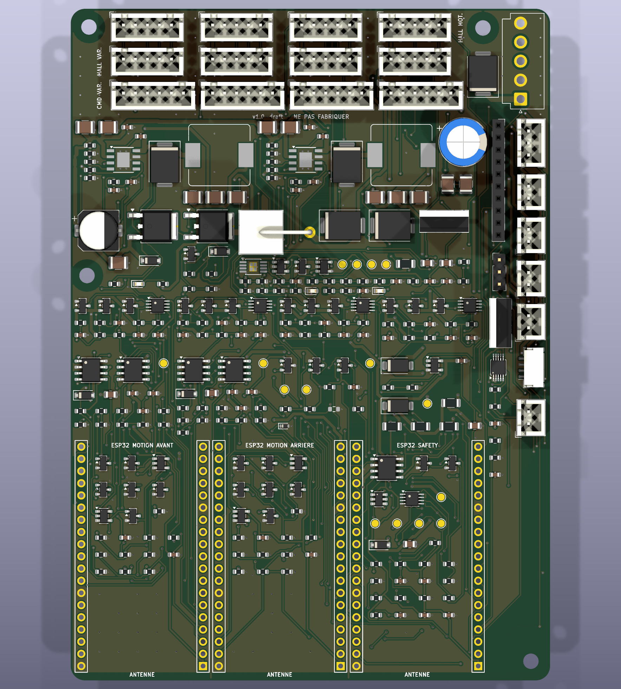

# Prototypage — single-board studies for the PCBWay sponsorship

Two studies made in November 2026 to see whether one board could replace the three v2
boards for a first, cheap build sponsored by PCBWay (60 €). **Neither fits the budget**
and neither is to be ordered as is. They are kept as a reference: circuits, GPIO tables,
IMU wiring and cost estimates are reused by later boards.

| Board | What it is | Checks | Estimated PCBWay order |
|---|---|---|---|
| [`mainboard`](mainboard/) | Option A: everything on one board, 30 A motor power in 2 oz copper, XT30 input, external contactor, 3 ESP32 sockets, IMU header. 180 × 150 mm, 2 layers | ERC 0, DRC 0, parity 0 | ≈ 120–245 € |
| [`logic_board`](logic_board/) | Option B: only the small-part circuits and the 3 ESP32 sockets; the 30 A path goes off board (MINI 58 V fuses, bus bars, external shunt). 100 × 140 mm, 2 layers, 1 oz | ERC 0; **routing unfinished** (48 unconnected) | ≈ 90–190 € + ≈ 60–140 € of off-board parts |

Both folders hold `bom_pcbway_fine.csv` / `centroid_pcbway_fine.csv`: PCBWay places only
the parts that cannot be hand-soldered (0603, SOT-23-5/6, fine pitch, thermal pads); see
[`../scripts/fab_pcbway.py`](../scripts/fab_pcbway.py) `--fine-only`. Prices are
estimates, not quotes. Details and open questions: each folder's `decisions.md` (French).

Routing note: never run more than one Freerouting at a time, with `-Xmx3g`; two parallel
runs at 14 GB each crashed the machine.
