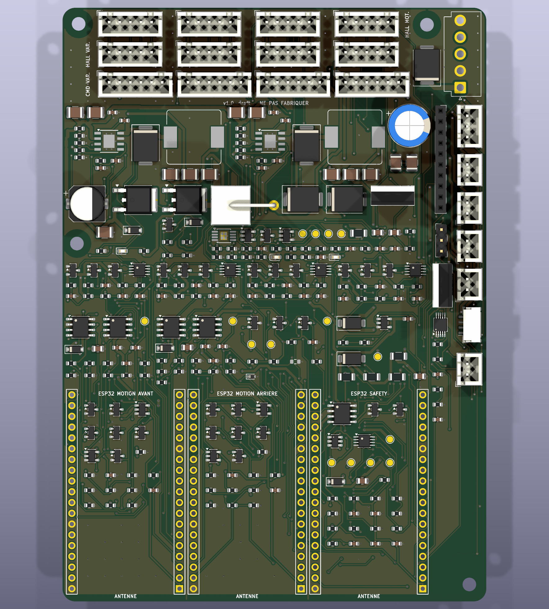

# logic_board — v1.0-draft (option B)

> **v1.0-draft — NE PAS FABRIQUER before P1, coil voltage, BMS level, and a review by an
> electronics engineer.**

Option B of the PCBWay comparison. Option A is [`../mainboard/`](../mainboard/): one big
board that also carries the 30 A motor power. It is left unchanged. This board keeps every
circuit whose parts are too small to solder by hand, so PCBWay can assemble it. The 30 A
path and the isolated 12 V PC converter move off board, onto wires, bus bars and
off-the-shelf fuse holders.

> ⚠️ **Routing is not finished.** The autorouted board still has **48 unconnected items**
> (31 signal connections and 17 cut-off pieces of the GND pours) and 12 dangling-track
> warnings. ERC is 0 and schematic parity is 0, placement and footprints are final, but the
> Gerbers in `fab/` are **for review and quoting only**: they must not be ordered until the
> remaining connections are finished by hand in KiCad (or the board goes to 4 layers).
> Details: [`decisions.md`](decisions.md) §3 (L11, L14) and §9.



## A or B: comparison

All money figures are **estimates, not a quote**: get an online PCBWay quote with each
`fab/` folder before deciding. Method and assumptions: [`decisions.md`](decisions.md) §8
and [`../mainboard/decisions.md`](../mainboard/decisions.md) §10.

| | A: `mainboard` | B: `logic_board` (this board) |
|---|---|---|
| PCB | 180 × 150 mm, 2 layers, **2 oz**, 1.6 mm | **100 × 140 mm**, 2 layers, **1 oz**, 1.6 mm |
| Board area | 270 cm² | 140 cm² (52 % of A) |
| Placed by PCBWay (`--fine-only`) | 192 parts, ≈ 496 pads | 190 parts, ≈ 492 pads |
| Unique machine-placed BOM lines | 50 | 49 |
| Full-SMD alternative (all SMD by PCBWay) | 273 parts / 78 lines | 267 parts / 74 lines |
| Soldered by William on the board | 120 (39 through-hole + 81 larger SMD) | 105 (28 through-hole + 77 larger SMD) |
| PCB, 5 boards | 40–80 € | 10–30 € (above the 100 × 100 price tier) |
| Assembly of 1 board (setup, stencil, ≈ 500 joints) | 30–80 € | 30–80 € |
| Fine SMD parts for 1 board | 30–50 € | 30–50 € (same ICs) |
| Shipping to France | 20–35 € | 20–35 € |
| **PCBWay order total** | **≈ 120–245 €** | **≈ 90–190 €** |
| Parts William buys that only this option needs | XT30, 4 × Keystone 3568, 5 A NANO2, M4/M5 bolts and lugs, 12 V PC terminal block: ≈ 15–25 € | Off-board power distribution (table below): ≈ 60–140 € |
| Parts William buys in both | larger SMD parts, connectors, sockets, IRL540N ×2, 10 Ω 5 W, 2200 µF, URB 12 V PC module (25–35 €), 22 Ω 100 W resistor, wires to the drivers, 3 DevKitC | same |
| Power wires (ends to crimp or bolt) | 16 | ≈ 24 (+ 8 inline fuse holders) |
| Signal connectors to plug | 18 | 20 (adds the power entry `J1` and the shunt Kelvin pair `J2`) |
| Battery connector | **XT30 on the board: 15 A continuous limit**, firmware cap 13 A | free choice on a wire: **XT60 proposed, no 15 A limit** (William's call) |
| 30 A copper | on the PCB, 2 oz, IPC-2152 approximation not checked by measurement | none on the PCB; 12 AWG wires and bus bars |
| Main safety risks | XT30 heating if the firmware limit fails; hot spot on the BUS_P neck | more bolted/crimped joints in the 30 A path (workmanship); fuse holder housings marked 32 V; Kelvin sense wires at bus potential without fuses |

**What the table says.** The machine-placed part count is the same: every small part is
on both boards. B saves on the bare PCB (smaller, 1 oz), so the PCBWay order is about
30–55 € cheaper, but William pays ≈ 35–115 € more for the off-board distribution (≈ 60–140 € of B-only parts minus ≈ 15–25 € of A-only parts) and has
more wiring to do. If the sponsorship covers only the PCBWay order, B moves cost from
PCBWay to William; neither option fits in 60 €. B's real gain is technical: no 30 A on
the PCB and no XT30 limit.

## What stays on the board

- The three **ESP32-DevKitC V4** on sockets (SAFETY, MOTION AVANT, MOTION ARRIÈRE): they
  are the wiring hub. CAN between them on traces (3 × `TCAN1042HVDR`, 120 Ω, XH to the
  CANable).
- **Power entry `J1`** (JST VH 5-pin): 1 BAT_F (fused 7.5 A off board), 2 GND, 3 BUS (fused
  7.5 A), 4 CHOP_N (from the chopper resistor), 5 GND. Input TVS `SMCJ48CA`.
- **5 V and 12 V AUX** (`TPS54360B` ×2, mainboard values), reverse-polarity FET,
  `5V_BRAKE` reservoir.
- **Precharge** (P-FET `SUD50P10-43L`, 10 Ω 5 W resistor standing up), output to the bus
  through `J1`-3.
- **Brake chopper**: analog control (`TPS7A4001`, `TLV1701`, `LM4040`, 0.1 % divider,
  `UCC27517`) and the `IRL540N`; the 22 Ω / 100 W resistor is off board.
- **Contactor coil** driver (`SN74AHCT1G08` → `IRL540N`), coil supply jumper, E-stop loops.
- **Safety chain**: `/SAFE`, watchdog latch (`TPL5010` → `74LVC1G74`).
- `INA228` with a Kelvin connector (`J2`) to the **off-board shunt**; VBAT and VBUS
  dividers.
- Hall taps, VR/DIR/STOP/EL for the four ZS-X11H, all JST XH driver connectors.
- IMU socket (1×10, BNO085 breakout order) and BMS JST GH.

GPIO tables are those of the mainboard (`../mainboard/decisions.md` §7), unchanged; the IMU
is wired as `firmware/esp32_safety/main/board_config.h`.

## Off-board power distribution

**Never route 30 A on perfboard.** The 30 A path is 12 AWG wire, crimped ring terminals,
two bus bars and inline fuse holders.

Ordinary blade fuses (ATO/ATC/MINI) are rated **32 V DC: do not use them on the 42 V
battery.** Littelfuse makes a **MINI 58 V** series (`0997`, 2–30 A, 1000 A breaking at
58 V DC) that fits MINI holders; the Littelfuse MINI FHM inline holder is listed as
compatible with both 32 V and 58 V MINI fuses (its housing is marked 32 V: see
"Not verified"). I found no ready-made fuse block rated ≥ 58 V DC at hobby prices.

```
                     12 AWG (30 A)                              18 AWG (≤ 7.5 A)
 BATTERY + ──XT60──[ BREAKER ]──● BAT+ (contactor battery terminal)
                                │
                                ├──[F5 7.5 A]──────────────────► J1-1 BAT_F   (logic board)
                                ├──[F8 3 A]────────────────────► 12 V PC module (+ in)
                                │
                         [ CONTACTOR ]   coil: J13; E-stop NC contact in series: J11
                                │
                         [ SHUNT 50 A / 75 mV ]──Kelvin screws──► J2-1 SNS_P, J2-2 SNS_N (twisted)
                                │
                    ════ BUS+ BAR ════
                      │    │    │    │    │
                   [F1] [F2] [F3] [F4] [F6 7.5 A]───────────────► J1-3 BUS
                    25A  25A  25A  25A   │
                      │    │    │    │  [F7 5 A]──[ 22 Ω 100 W ]──► J1-4 CHOP_N
                   AV_G AV_D AR_G AR_D   (ZS-X11H power +)
                      │    │    │    │
 BATTERY − ──XT60── ════ GND BAR ════ ─────────────────────────► J1-2 and J1-5 GND
                                └──► 12 V PC module (− in); isolated 12 V out → PC
```

Rules: every wire leaving a bus bar goes through its fuse first, mounted close to the bar;
crimp (do not only solder) ring terminals; the GND bar is the single star point (the
negative is never switched).

### What William buys for option B (estimates)

| # | Part | Qty | Estimate |
|---|---|---|---|
| 1 | XT60 pair (male + female), or keep an XT30 pair with the 15 A limit | 1 | 1–3 € |
| 2 | Bus bar, 4–6 studs, ≥ 100 A (one BUS+, one GND) | 2 | 10–24 € |
| 3 | DC shunt 50 A / 75 mV (1.5 mΩ, FL-2 type) | 1 | 3–8 € |
| 4 | Littelfuse MINI FHM inline holder, 12 AWG, 30 A (`0FHM0002ZXJ`), for F1–F4 | 4 | 12–32 € |
| 5 | Littelfuse MINI FHM inline holder, 14 AWG, 20 A (`0FHM0001ZXJ`), for F5–F8 | 4 | 10–25 € |
| 6 | MINI 58 V fuses: 4 × 25 A (`0997025.WXN`), 2 × 7.5 A, 1 × 5 A, 1 × 3 A (`0997` series), + spares | 8+ | 4–10 € |
| 7 | Silicone wire 12 AWG red/black (2 m each), 18 AWG (3 m), 24 AWG twisted pair | — | 10–20 € |
| 8 | Ring terminals M5/M6, heat-shrink, sleeving for the Kelvin pair | — | 5–10 € |
| 9 | JST VH 5-pin housing + crimps (`VHR-5N`, `SVH-21T-P1.1`), XH 2-pin housing | 1 | 1–3 € |
| 10 | Small perfboard + 2 screw terminals for the URB 12 V PC module (module itself counted in both options) | 1 | 2–4 € |
| | **Total** | | **≈ 60–140 €** |

Lead times: Littelfuse FHM holders showed long distributor lead times (weeks) when
checked; order early or ask for an equivalent holder rated for 58 V MINI fuses.

## Status

v1.0-draft, generated by `scripts/build.py` (KiCad 10), checked with `kicad-cli` on
24 Nov 2026:

| | |
|---|---|
| Size | 100 × 140 mm, 2 layers, **1 oz**, 1.6 mm, 4 × M3 holes |
| ERC | 0 |
| DRC (all severities, schematic parity) | **not clean**: 48 unconnected items (31 signal, 17 GND pour pieces), 12 `track_dangling` warnings, 0 other violations, 0 parity issues |
| Vias | 852 (183 GND fan-out vias placed before routing, stitching and joining vias) |
| Parts | 311 schematic symbols; `--fine-only`: 190 placed by PCBWay, 105 by hand, 102 BOM lines |
| Fab outputs | `fab/`: Gerber + drill zip, `bom_pcbway.csv` / `centroid_pcbway.csv` (all SMD), `bom_pcbway_fine.csv` / `centroid_pcbway_fine.csv` (fine parts only), schematic and assembly PDFs, renders |

**Not routed to completion, not manufactured, not measured, not reviewed.** Why not 100 × 100 mm: the two buck
inductors (13.5 × 12.5 mm, kept from the mainboard) and the twelve driver connectors fill
the top band, and at 100 × 110 and 100 × 120 mm the routing under the modules cut both
ground pours into islands; details in `decisions.md` §3.

## Files

| | |
|---|---|
| [`cahier-des-charges.md`](cahier-des-charges.md) | specification (French) |
| [`decisions.md`](decisions.md) | what left the board and why, 1 oz copper, off-board distribution, firmware changes, cost, open questions (French) |
| [`scripts/build.py`](scripts/build.py) | the whole circuit, schematic and layout (copied from the mainboard script, same values) |
| [`scripts/lblib.py`](scripts/lblib.py) | local symbols and footprints (copy of `mblib.py`, reuses `safety_power/scripts/splib.py`) |
| [`scripts/patchroute_lb.py`](scripts/patchroute_lb.py) | post-routing clean-up (copy of `patchroute_mb.py`, no power strip) |
| `build.sh` | schematic → placement → Freerouting → clean-up → ERC/DRC |
| `fab.sh` | PCBWay outputs in `fab/` |

```sh
./build.sh      # full build, Freerouting takes a while
./fab.sh        # fabrication outputs
```

## Open questions for William

1. Battery connector off board: **XT60** (removes the 15 A limit) or keep the XT30?
2. Is a 100 × 140 mm board acceptable, or should the bucks be redesigned with smaller
   inductors to reach 100 × 100 mm?
3. Does the PCBWay sponsorship cover only their order? Then B shifts ≈ 35–115 € of parts to you.
4. Same open points as the mainboard: contactor coil voltage (JP1), E-stop DC breaking
   capacity, BMS logic level (R67), P1 and P3.
5. Finish the last ≈ 50 connections by hand in KiCad (a few hours for someone used to it),
   or accept a 4-layer board (inner GND plane; likely ≈ 100 × 110 mm, higher PCB price)?
