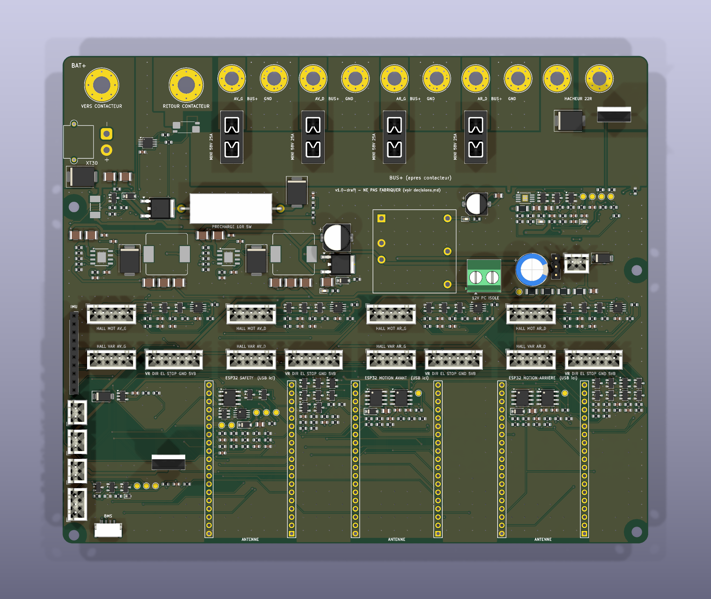

# mainboard — v1.0-draft

> **v1.0-draft — ne pas fabriquer avant P1, coil voltage, BMS level, and a review by an
> electronics engineer.**

One board for Retriever's first, cheap build. It replaces the three v2 boards
(`safety_power`, `motor_interface` ×2, `safety_bus_distribution`).



## What it carries

- **Battery input on an XT30** (`XT30PW-M`), input TVS `SMCJ48CA`.
- Two M5 lug terminals to and from William's **external mechanical contactor**
  ("VERS CONTACTEUR" = BAT+, "RETOUR CONTACTEUR" = BUS+). No static contactor.
- **Precharge** (P-FET `SUD50P10-43L`, 10 Ω / 5 W on board) driven by the SAFETY ESP32.
- **Brake chopper**: the analog, bus-powered block of `safety_power` v2.1, unchanged
  (ON 43.0 V / OFF 42.3 V); 22 Ω / 100 W resistor off board on an M4 lug pair.
- **4 driver outputs** (BUS+ / GND, M4 lugs) behind Littelfuse MINI 58 V 25 A fuses in
  Keystone 3568 holders.
- Bus current (`INA228` + 1 mΩ shunt), VBAT and VBUS on the SAFETY ADC.
- **Hotel rails** upstream of the contactor, behind a 5 A fuse: 5 V and 12 V AUX
  (`TPS54360B`), isolated 12 V for the PC (Mornsun `URB4812YMD-30WR3`), `5V_BRAKE` with a
  2200 µF reservoir.
- **Three ESP32-DevKitC V4** on sockets (SAFETY, MOTION_AVANT, MOTION_ARRIERE), CAN on
  traces (3 × `TCAN1042HVDR`, 120 Ω on board, XH connector to the CANable).
- **Safety chain**: `/SAFE` through the E-stop NC loop, SAFETY hold MOSFET, `TPL5010` →
  `74LVC1G74` watchdog latch; contactor coil driven low side with the E-stop's second NC
  contact in series.
- Motor control per pair of drivers: Hall passthrough with the v2 tap, DIR/STOP open
  drain, EL = GPIO AND `/SAFE`, VR = ESP32 DAC × 1.68 (`TLV9062`).
- BNO085 IMU socket (1×10, breakout pin order) and BMS JST GH connector.

## ⚠️ XT30 current limit

William chose an **XT30** battery connector. An XT30 is rated about **15 A continuous /
30 A peak** (distributor data; Amass datasheet value not read). The four motors can draw
≈ 30 A. **Total motor current must stay within 15 A continuous**, or the connector
heats. The SAFETY firmware must enforce a bus current limit with the on-board `INA228`
(proposed: 13 A continuous, 25 A for 2 s). An XT60 does **not** fit the XT30 footprint:
moving to an XT60 needs a board revision. The rest of the 30 A path is already sized for
30 A. Details: [`decisions.md`](decisions.md) §2.

## Status

v1.0-draft, generated by `scripts/build.py` (KiCad 10), checked by `kicad-cli` on 23 Nov 2026:

| | |
|---|---|
| Size | 180 × 150 mm, 2 layers, **2 oz copper**, 1.6 mm, 4 × M3 holes |
| ERC | 0 |
| DRC (all severities, schematic parity) | 0 violations, 0 unconnected, 0 parity issues |
| Parts | 273 SMD placed by PCBWay, 39 through-hole soldered by hand, 114 BOM lines |
| Fab outputs | `fab/`: Gerber + drill zip, `bom_pcbway.csv` (SMD/THT, who places what), `centroid_pcbway.csv` (SMD only), schematic and assembly PDFs, renders |

**Not manufactured, not measured, not reviewed.** Blocking: P1 (DevKitC row spacing),
contactor coil voltage, BMS logic level, and a review by an electronics engineer. Routing is
Freerouting + clean-up + about ten hand repairs on this board; a rebuild gives an equivalent,
not identical, board. Cost estimate (well above the 60 € budget) in `decisions.md` §10.

## Files

| | |
|---|---|
| [`cahier-des-charges.md`](cahier-des-charges.md) | specification (French) |
| [`decisions.md`](decisions.md) | every choice and its reason, IPC-2152 copper, GPIO tables, rail budgets, cost estimate, open questions, ICD proposals (French) |
| [`scripts/build.py`](scripts/build.py) | the whole circuit, schematic and layout, described once |
| [`scripts/mblib.py`](scripts/mblib.py) | local symbols and footprints (reuses `safety_power/scripts/splib.py`) |
| [`scripts/patchroute_mb.py`](scripts/patchroute_mb.py) | post-routing clean-up, copy of `safety_power/scripts/patchroute.py` for 2 layers |
| [`sim/`](sim/) | chopper and precharge ngspice decks (`precharge_court.cir`: shorted bus) |
| `build.sh` | schematic → placement → power copper → Freerouting → patchroute → ERC/DRC |
| `fab.sh` | PCBWay outputs in `fab/` (Gerber zip, BOM, centroid, PDFs, renders) |
| [`../../scripts/fab_pcbway.py`](../../scripts/fab_pcbway.py) | PCBWay BOM (SMD/THT, who places what) and SMD-only centroid |

```sh
./build.sh      # full build, Freerouting takes several minutes
./fab.sh        # fabrication outputs
```

## Open questions for William

1. Accept a firmware motor current limit of ≈ 13 A total because of the XT30?
2. Contactor coil voltage and current (jumper JP1: 12 V or battery; shipped without jumper).
3. DC breaking capacity of the E-stop NC contacts.
4. BMS logic level (3.3 V or 5 V, fit R67 for 5 V).
5. P1 (DevKitC row spacing) and P3 (PSRAM).
