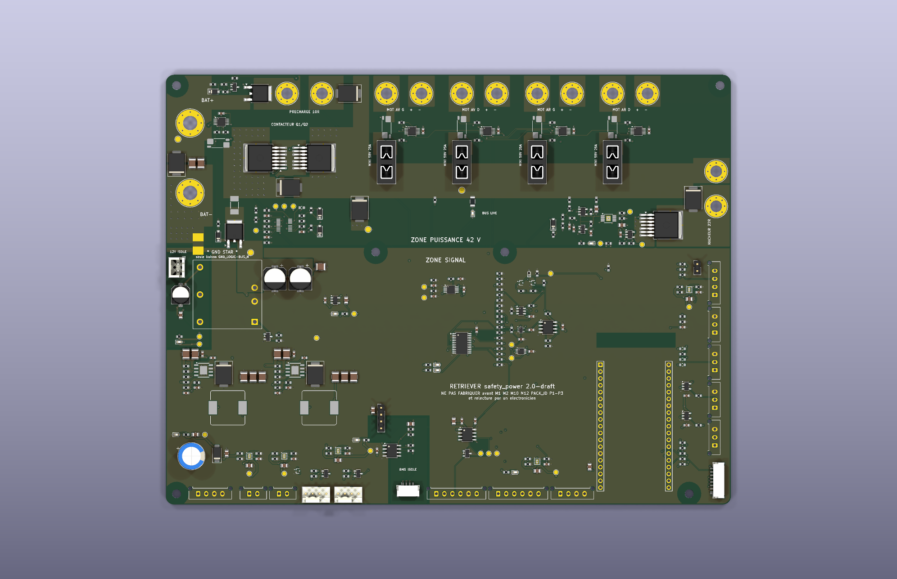

# safety_power

> ⚠️ **v2.0-draft — do not manufacture before M1, M2, M10, M12, PACK_ID, P1–P3 and a
> review by an electronics engineer.** Schematic and layout are generated and checked
> (ERC/DRC below); nothing has been built, measured or reviewed. This board switches
> 42 V / 30 A on a 474 Wh lithium pack. Every choice, every computed value, what is not
> verified and what an expert must look at: [`decisions.md`](decisions.md) (French).
> Brief: [`cahier-des-charges.md`](cahier-des-charges.md).

  

| | |
|---|---|
| Status | **v2.0-draft** — ERC 0 · DRC 0 (`--schematic-parity --severity-all`) · 0 unconnected · parity 0. Not fabricated, not reviewed |
| Size | 210 × 160 mm, 4 layers, 2 oz outer copper, 6 × M3 (unplated, no chassis bond) |
| Parts | 344 symbols, 350 footprints; JLCPCB BOM 111 lines / 298 placements (THT connectors and modules included); hand-fitted: 4 fuse holders, ESP32 sockets, ring lugs |
| Contactor | `TPS48100QDGXRQ1` (in stock at JLCPCB, C43131316) + 2 × `IPB017N10N5LF` back-to-back, 1 mΩ 4-wire shunt, SCP ≈ 99 A / 100 µs latched |
| Rails (upstream of the contactor) | 5 V 3.5 A and 12 V AUX 2 A on `TPS54360B`; 12 V 30 W isolated `URB4812YMD-30WR3`; 3.3 V `AP2112K` |
| Sources | [`kicad/`](kicad/) — KiCad 10 project, **generated** by [`scripts/build.py`](scripts/build.py) (+ [`scripts/splib.py`](scripts/splib.py) for the symbols and footprints KiCad lacks) |
| Fabrication | [`fab/`](fab/) — Gerber zip, JLCPCB BOM and placement, schematic PDF, assembly drawing, renders |

Rebuild everything: `./build.sh` (placement, power copper, Freerouting, then a
clean-up pass by [`scripts/patchroute.py`](scripts/patchroute.py); 30–60 minutes) then
`./fab.sh`. Freerouting is not deterministic: a rebuild gives an equivalent board, not an
identical one, and may leave a connection for the clean-up pass or for hand routing. The
committed board took one hand-placed via (net `EFUSE_FLT_N`, near U14) after that pass. Toolchain: [`../outils.md`](../outils.md). Do not edit the
KiCad files by hand: change `scripts/build.py` and rebuild.

## What it does

The board that decides whether the robot may move.

- **Battery in** on two M5 ring-lug studs (`J1`), after the manual battery switch and the
  MRBF fuse.
- **Static contactor**: `TPS48100-Q1` driving two `IPB017N10N5LF` back to back, common
  source, so the switch blocks both discharge and regeneration. Two independent gate
  drives on `INP1`/`INP2` make a per-transistor stuck-switch test possible (`MID` node
  read by an ADS1115). Bidirectional `SMCJ48CA` across the switch, Schottky freewheel on
  the bus, 150 Ω turn-off gate resistors.
- **Precharge** through an off-board 10 Ω / 25 W resistor (`J13`), P-FET driven by the
  ESP32, not by the controller.
- **Brake chopper**: analogue comparator powered **by the bus itself** through a 100 V LDO,
  42.5 V on / 41.8 V off, 22 Ω / 100 W off-board (`J12`). It also serves as the active bus
  discharge when the ESP32 asks for it with the contactor open.
- **Four motor branches**, each with a MINI 58 V 25 A blade fuse in a PCB holder, a 2 mΩ
  4-wire shunt and an `INA228` whose bus input sits after the fuse (blown-fuse detection).
- **Hotel rails taken upstream of the contactor** (decision D2), so the SAFETY ESP32, the
  `/SAFE` pull-up and `5V_BRAKE` survive an open contactor.
- **SAFETY ESP32** (DevKitC V4 on sockets), CAN (`TCAN1042HV`), the **single** `/SAFE`
  pull-up through the mushroom's NC contact and the single pull-down, a `TPL5010`
  watchdog **latched** by a D flip-flop together with an ACS758 window comparator
  (± 35 A), an isolated BMS UART, the remote BNO085, two fans, two WS2812B strips and a
  temperature input.
- **One ground bond**, `★ GND STAR`, between `GND_LOGIC` and `BUS_N`, silkscreened.

## Layout

Strict zoning: the 42 V power zone across the top 64 mm, the signal zone below, split
along a line where the inner and bottom ground planes change from `BUS_N` to `GND_LOGIC`.
The high-current copper (battery, drain planes, bus bar, branches, chopper) is drawn by
the script as polygons on F.Cu with stitched B.Cu/In1 return planes, and is handed to the
autorouter as planes: Freerouting only routes signals. Clearance on 42 V power copper is
0.5 mm.

**Routing quality is draft quality.** The autorouter used the inner ground layer (In1) for
about 450 short signal segments, which cuts the `GND_LOGIC`/`BUS_N` planes into a lace,
and it routed both switching regulators. Both must be redone by hand before anyone orders
this board (see *Relecture experte* in `decisions.md`).

## Blocking measurements

M1 (BMS cut-off), M2 (pack resistance), M10 (bus capacitance), M12 (driver input
capacitor rating), PACK_ID (pack and BMS labels), P1–P3 (ESP32 module footprint, pin
order, PSRAM variant). See [`docs/measurements/`](../../../docs/measurements/).

Pinout: `boards.safety_power` in [`hardware/icd.yaml`](../../icd.yaml). The board departs
from ICD v1.2 in a few places (ring-lug studs, MINI 58 V fuses, new `5V_BRAKE`
connectors J22/J23, BMS on JST GH): the proposed v1.3 changes are listed at the end of
[`decisions.md`](decisions.md).

  

